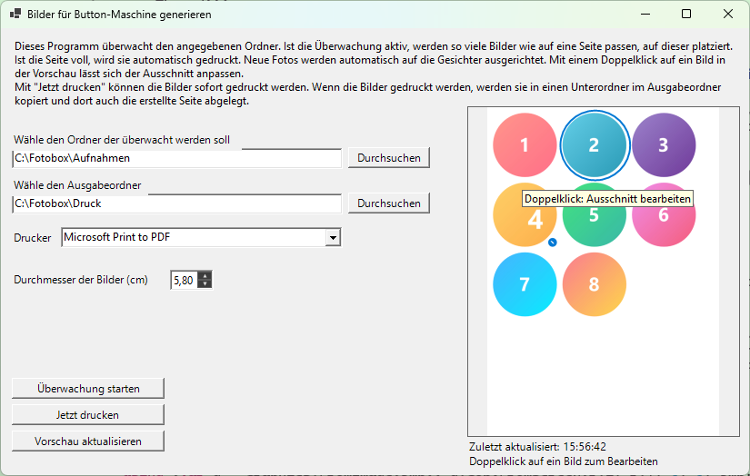

# PrintImageForButtonMachine

Windows-Programm, das Fotos für eine Buttonmaschine druckfertig aufbereitet. Es überwacht einen Ordner, in dem z. B. eine Fotobox ihre Aufnahmen ablegt, richtet jedes Foto auf die Gesichter aus, schneidet es kreisrund zu und ordnet die Kreise auf einer A4-Seite an. Sobald die Seite voll ist, wird sie automatisch gedruckt.



## Funktionen

- **Ordnerüberwachung:** prüft alle 2 Sekunden den überwachten Ordner auf neue `*.jpg`-Dateien
- **Live-Vorschau** der aktuellen Seite, wird nur bei Änderungen neu berechnet
- **Automatische Ausrichtung:** Neue Fotos werden einmalig auf Gesichter untersucht (in Windows eingebaute Erkennung, offline). Der Kreis wird auf die Gesichter zentriert; bei Einzelpersonen bestimmt die Gesichtsgröße den Zoom, bei Gruppen der Abstand der Gesichter, sodass alle im später sichtbaren Bereich liegen. Ohne erkanntes Gesicht wird mittig über die volle Bildhöhe ausgeschnitten.
- **Ausschnitt von Hand anpassen:** Doppelklick auf einen Kreis in der Vorschau öffnet ein Bearbeiten-Fenster. Ziehen verschiebt das Foto, das Mausrad zoomt. Ein gestrichelter Hilfskreis (Radius 4 mm kleiner) zeigt, was nach dem Pressen auf dem Button sichtbar bleibt. Von Hand angepasste Kreise tragen in der Vorschau ein Stift-Symbol; „Automatisch“ stellt den Vorschlag wieder her.
- **Begleitdateien:** Erkannte Gesichter und Handkorrekturen liegen als `<Foto>.button.json` neben dem Foto und bleiben über einen Neustart erhalten
- **Automatischer Druck**, sobald so viele Bilder vorhanden sind, wie auf eine Seite passen
- **Manueller Druck** über „Jetzt drucken“, auch wenn die Seite noch nicht voll ist; während die Seite aufbereitet und gedruckt wird, zeigt die Vorschau „Seite wird gedruckt …“
- Solange ein Bearbeiten-Fenster offen ist, wird nicht automatisch gedruckt
- **Druck in Originalgröße mit 300 dpi**: Die Kreise haben auf dem Papier exakt den eingestellten Durchmesser
- **Archivierung:** Vor dem Druck werden die Fotos in einen Unterordner mit Zeitstempel im Ausgabeordner verschoben; die Begleitdateien wandern mit, die gedruckte Seite wird dort als `print.jpg` abgelegt

## Einstellungen

| Einstellung | Bedeutung |
|---|---|
| Überwachter Ordner | Ordner, in dem neue Fotos erwartet werden |
| Ausgabeordner | Ziel für die verschobenen Fotos und die gedruckten Seiten; muss sich vom überwachten Ordner unterscheiden |
| Drucker | Drucker, auf dem die Seiten ausgegeben werden |
| Durchmesser der Bilder (cm) | Durchmesser der Kreise auf der gedruckten Seite, passend zur Buttongröße |

Während die Überwachung läuft, sind die Einstellungen gesperrt.

## Download

Die aktuelle Version gibt es unter [Releases](https://github.com/mw-j/printImageForButtonMachine/releases/latest): `PrintImageForButtonMachine.exe` herunterladen und starten, eine Installation ist nicht nötig.

Da die Datei nicht signiert ist, warnt Windows SmartScreen beim ersten Start („Der Computer wurde durch Windows geschützt“). Über „Weitere Informationen“ → „Trotzdem ausführen“ lässt sich das Programm starten.

## Voraussetzungen

- Windows 10 (ab Version 2004) oder 11
- Zum Bauen: [.NET 10 SDK](https://dotnet.microsoft.com/download/dotnet/10.0); die Release-Version bringt die Laufzeit bereits mit

## Bauen und Starten

```powershell
dotnet build
dotnet run --project PrintImageForButtonMachine
```

Alternativ `PrintImageForButtonMachine.sln` in Visual Studio 2026 öffnen.

Eine eigenständige Programmdatei, die ohne installierte Runtime läuft, erzeugt:

```powershell
dotnet publish PrintImageForButtonMachine -c Release -r win-x64 --self-contained -p:PublishSingleFile=true
```

## Lizenz

[MIT](LICENSE)
